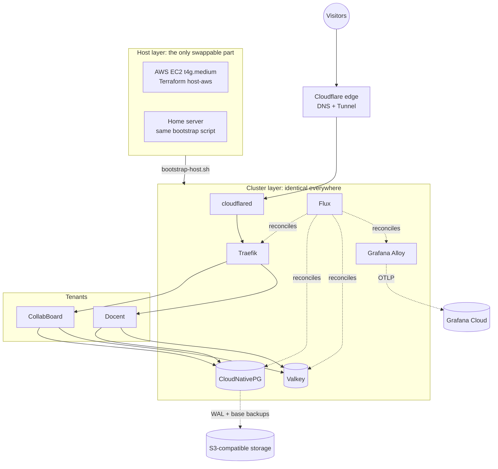

# Basecamp

A small internal developer platform that every project in this portfolio actually runs on: one Graviton instance on AWS, k3s, GitOps with Flux, Postgres via CloudNativePG, policy-as-code, and **zero inbound firewall rules**. About $32/month for everything on it.

The cluster layer is host-agnostic. The same repo brings the platform up on EC2 or on a home server with only the host layer swapped. CI proves that on every PR by bootstrapping the cluster in k3d.

> **Status: bootstrapping.** This repo is being built in the open, issue by issue. See the [phase-1 backlog](https://github.com/AndyV99/basecamp/issues).

## Architecture



| Layer | Choice |
|---|---|
| Host | EC2 `t4g.medium` (4 GB), public subnet, no NAT, security group with no ingress rules |
| Ingress | Cloudflare Tunnel → Traefik (no load balancer, no open ports) |
| GitOps | Flux, with per-PR preview environments |
| Data | CloudNativePG (one cluster, a database per tenant), Valkey |
| Policy | Built-in ValidatingAdmissionPolicy, Conftest on Terraform plans |
| Secrets | SOPS + age, encrypted in git |
| Observability | Grafana Alloy → Grafana Cloud |

Decisions are recorded as ADRs in [`docs/adr/`](docs/adr/) as they're made.

## Working in this repo

Run once per clone:

```sh
scripts/setup-hooks.sh
```

This installs a pre-commit hook that runs gitleaks, pinned by version and checksum, with the same config CI uses. See the script's header for why it can't be automatic and what covers you if you skip it.

Every change goes through a PR into `main`. The single required check is `ci`.
